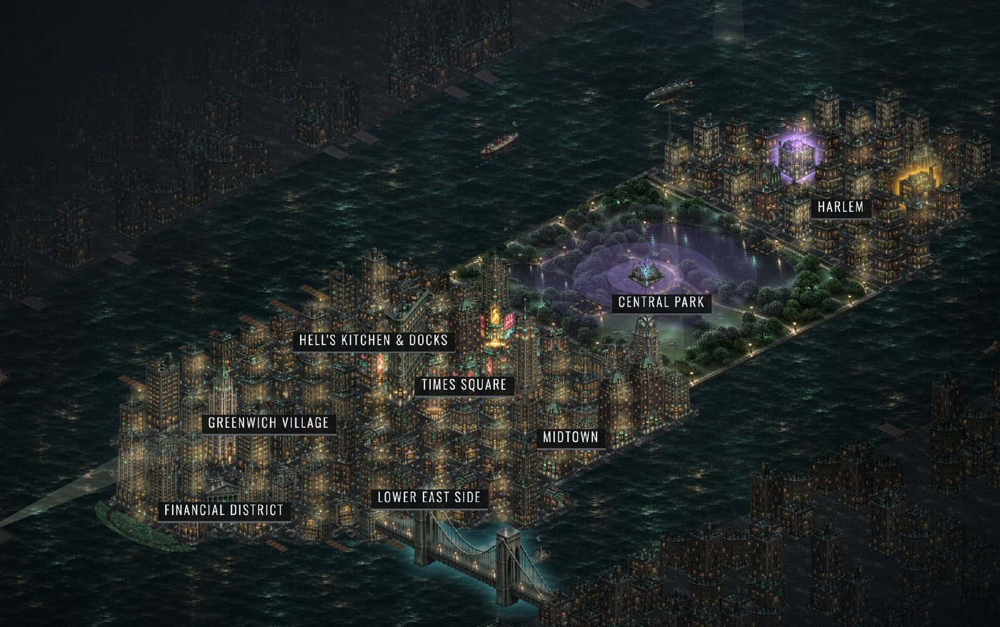
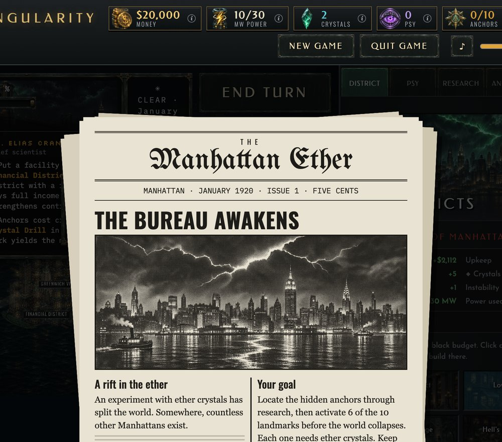

# Singularity

**Run 1920s Manhattan as the government nobody knows exists.**
One city, countless parallel universes – and only ten anchors to hold and stabilise your universe.

Singularity is a turn-based strategy game in the browser. You lead a secret division of the Bureau of Investigation, build laboratories, crystal drills and Tesla towers across Manhattan's districts, recruit famous scientists, use psy actions on the population and hunt for the ten landmarks that keep your version of reality from collapsing into the ether.

▶ **Play it:** [singularity.cognitronics.ai](https://singularity.cognitronics.ai)


## Screenshots

| | |
|---|---|
|  |  |
| **Manhattan at night** – every district has its own buildings, Central Park hides the Rift | **Weather** – rain, fog and thunderstorms roll over the rivers |
|  |  |
| **The Manhattan Ether** – every turn starts with the news | **The retro version** – the original pixel-art prototype |

## Two versions

| | Folder | Look |
|---|---|---|
| **V2** (current) | [`site/play2/`](site/play2/) | Painted isometric art in a dark, Fringe-like 1920s mood, art deco interface |
| **Retro** (V1) | [`site/play/`](site/play/) | The original pixel-art version |

Both are single-file HTML/JavaScript games drawn on a `<canvas>` – no build step, no framework. Each has a `mobile.html` variant with a phone layout (generated from `index.html`, see `tools/make_mobile*.sh`).

## Gameplay in short

- **48 turns, 6 epochs.** Hold **6 of the 10 anchors** at the end of an epoch to win.
- **Districts:** Financial District, Lower East Side, Greenwich Village, Hell's Kitchen & Docks, Times Square, Midtown, Central Park and Harlem – each with its own income, quirks and three build slots.
- **Facilities:** coal and Tesla generators, laboratories, crystal drills, radio towers, stabilisers and portals.
- **Resources:** money, power, ether crystals, psy and research.
- **Instability:** if it reaches 100 %, your universe falls into the Singularity.
- **Scientists:** Tesla, Curie, Einstein, Bohr, Meitner, Goddard, Noether and Hubble join the bureau in secret and reveal anchors. Their cards already carry espionage and sabotage values for a planned multiplayer mode.

The full rules are in the in-game *Bureau Manual* (Help button).

## Run it locally

The game needs to be served over HTTP (browsers block canvas pixel access on `file://`):

```bash
cd site
python3 -m http.server 8000
# open http://localhost:8000/play2/
```

## Deploy

The site is static and runs in an `nginx:alpine` container behind Nginx Proxy Manager:

1. Copy this folder to the server, e.g. `/var/www/singularity`.
2. Set the Nginx Proxy Manager network name in `docker-compose.yml` (`docker network ls`).
3. `docker compose up -d`
4. Point a DNS record at the server and add a proxy host in Nginx Proxy Manager (port 80, Let's Encrypt SSL).

## How the art was made


- **V2:** buildings, landmarks, vehicles, portraits, panel art and UI frames were generated with [Higgsfield](https://higgsfield.ai) (GPT Image 2.6) from one style concept (above). Every map sprite was generated with a second reference image for the camera angle and then checked for a straight 2:1 isometric view (`tools/measure_iso.py`). Streets are seamless painted textures projected onto the map grid (`tools/ground_v2.py`).
- **Retro (V1):** sprites were generated with [PixelLab](https://pixellab.ai); the ground, park, bridge, water and logo are drawn by the Python scripts in `tools/`.
- All V2 images are served as WebP; the game pre-shades sprites once instead of using canvas filters, which keeps start-up at a few seconds.

## Repository layout

```
site/            the website (singularity.cognitronics.ai)
  index.html     landing page
  devlog.html    devlog, posts/ – the articles
  play/          retro version (V1, pixel art)
  play2/         current version (V2)
  play/music/    soundtrack (shared by both versions)
tools/           Python/shell scripts used to build sprites, ground and mobile pages
docs/screenshots images for this README
```
