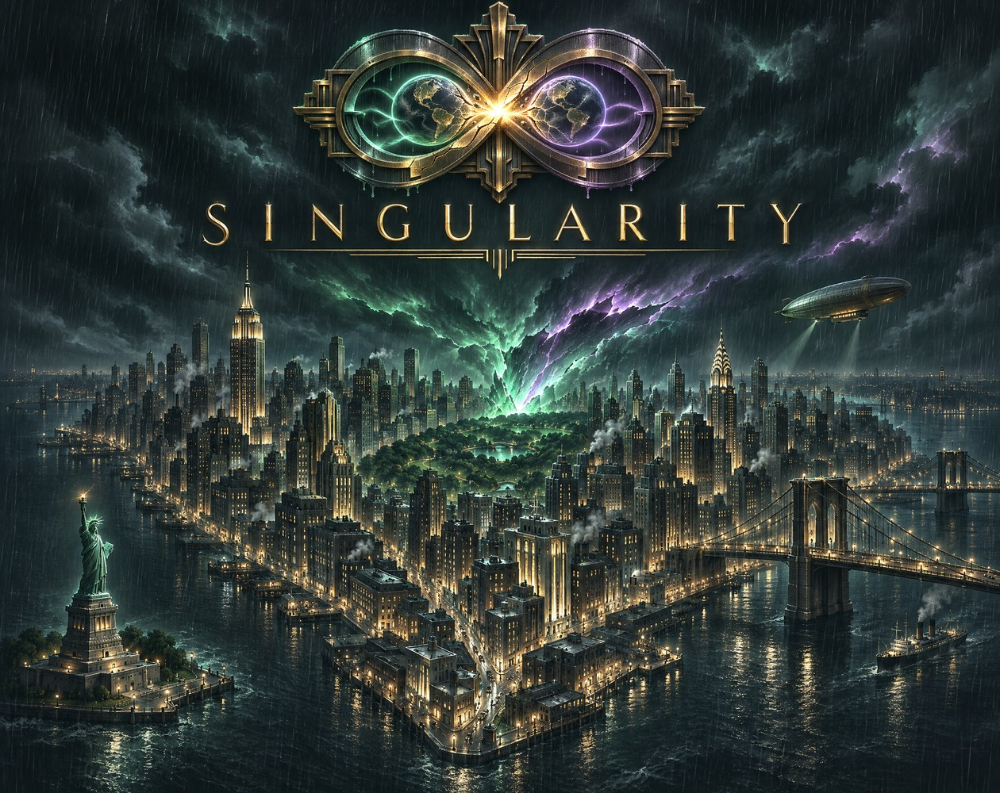
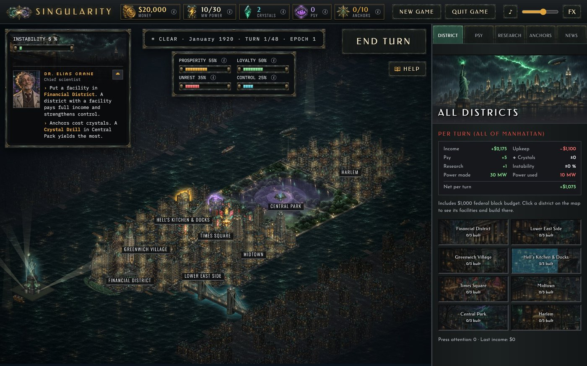
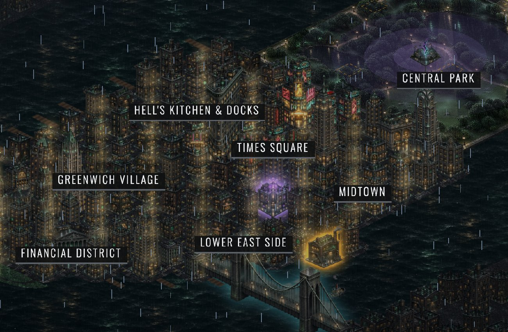
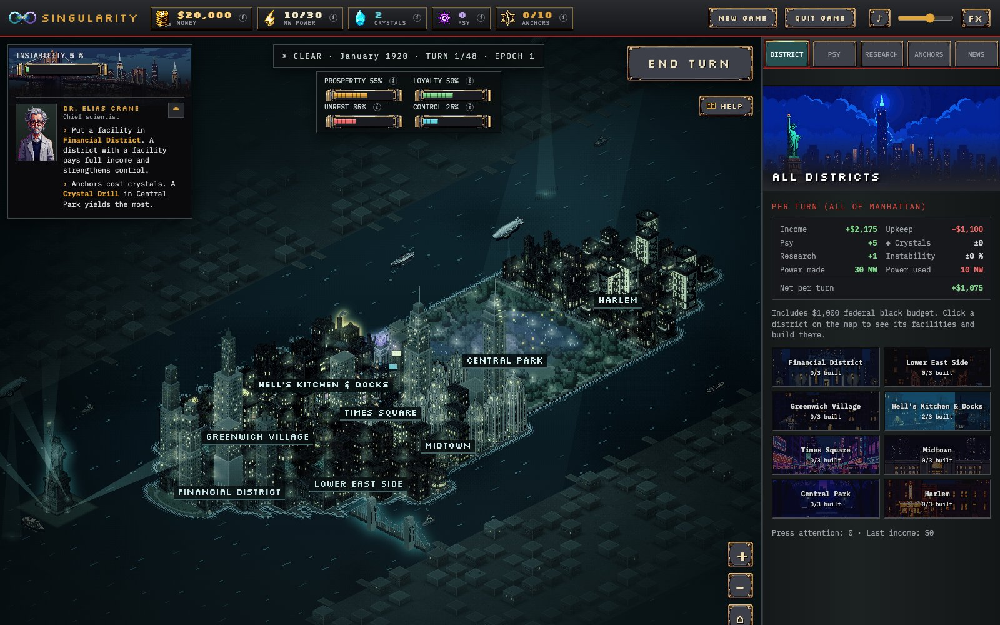
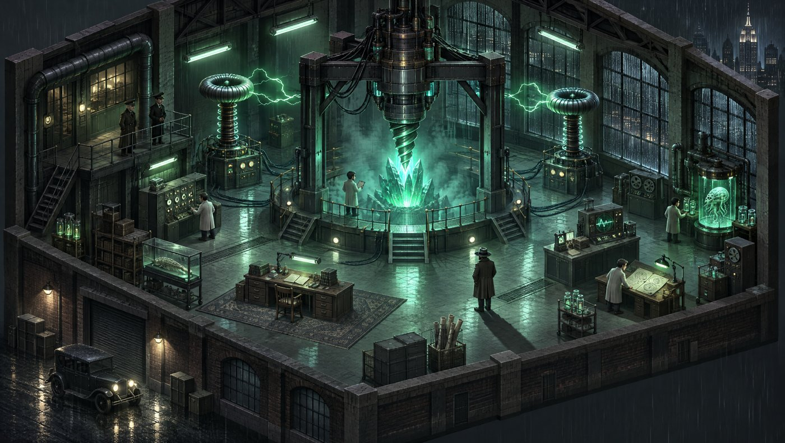

# Singularity

**Run 1920s Manhattan as the government nobody knows exists.**
One city, countless parallel universes – and only ten anchors to hold and stabilise your universe.

Singularity is a turn-based strategy game in the browser. You lead a secret division of the Bureau of Investigation, build laboratories, crystal drills and Tesla towers across Manhattan's districts, recruit famous scientists, use psy actions on the population and hunt for the ten landmarks that keep your version of reality from collapsing into the ether.

▶ **Play it:** [singularity.cognitronics.ai](https://singularity.cognitronics.ai)



## The story

*Manhattan, 1919. One night, every light in the city went out. When they came back on, there was more than one Manhattan.*

In a basement laboratory beneath the Lower East Side, Dr. Elias Crane tried to draw limitless energy from ether crystals. The experiment tore a rift between worlds: ferrymen see a second Brooklyn Bridge in the fog, clocks stop, people meet themselves on the street. Washington has quietly founded a division of the Bureau of Investigation that officially does not exist – and you lead it. Find the ten anchors before your world falls apart.

## Trailer

[](site/play2/intro.mp4)

The 24-second trailer also plays as the intro when the game starts (Esc, Enter, Space or a click skips it). It was made from Higgsfield stills animated with Seedance 2.0 Mini, one short clip per scene, then cut together with text overlays and the game's own soundtrack.



## Screenshots

| | |
|---|---|
|  |  |
| **Manhattan at night** – every district has its own buildings, Central Park hides the Rift | **Weather** – rain, fog and thunderstorms roll over the rivers |
|  |  |
| **The Manhattan Ether** – every turn starts with the news | **The retro version** – the original pixel-art prototype |

## Versions

| | Folder | What it is |
|---|---|---|
| **V4 Dev Edition** | [`site/play4/`](site/play4/) | Work in progress: 1–3 rival universes played by bots, great projects, the Parallel Universe View |
| **V3** (current) | [`site/play3/`](site/play3/) | Combinable tech tree, endless mode, difficulty levels, online Hall of Fame, save & load |
| **V2** | [`site/play2/`](site/play2/) | Painted isometric art in a dark 1920s noir mood, art deco interface, intro trailer |
| **Retro** (V1) | [`site/play/`](site/play/) | The original pixel-art version |

All are single-file HTML/JavaScript games drawn on a `<canvas>` – no framework. Each has a `mobile.html` variant with a phone layout.

V4 is **generated** from V3: `tools/build_v4.sh` copies `site/play3/index.html` and applies the patch scripts `tools/v4_*.py` in order (rivals → view → Wardenclyffe → FBI → projects → HAARP → P.E.A.C.E.). Change V3 or a patch script, then rebuild – do not edit `site/play4/index.html` by hand.

## Gameplay in short

- **Epochal** (48 turns, 6 epochs) or **Endless** mode; Easy / Normal / Hard. Hold 4, 5 or 6 of the 10 anchors at the end of an epoch to win.
- **Districts:** Financial District, Lower East Side, Greenwich Village, Hell's Kitchen & Docks, Times Square, Midtown, Central Park and Harlem – each with its own income, quirks and three build slots.
- **Facilities:** coal and Tesla generators, laboratories, crystal drills, radio towers, stabilisers and portals.
- **Resources:** money, power, ether crystals, psy and research.
- **Instability:** if it reaches 100 %, your universe falls into the Singularity.
- **Tech tree (V3):** twelve principles combine at the bench into 32 secret inventions – facilities, modules, edicts and psy actions. See [`docs/design/tech-tree.md`](docs/design/tech-tree.md).
- **Scientists:** Tesla, Curie, Einstein, Bohr, Meitner, Goddard, Noether and Hubble join the bureau in secret, reveal anchors and recipes – and in V4 go on spy and sabotage missions.
- **Rival universes (V4):** full bot-played games racing you for the same anchors. Great projects by technological stage – Wardenclyffe Tower, Observatory, Portal, Federal Bureau of Investigation, Parallel Universe Pictureframe, HAARP (weather control and a stealth veil) and P.E.A.C.E., the Particle Ether Accelerator for Cosmic Erasure. An Observer gives cryptic hints.

The full rules are in the in-game *Bureau Manual* (Help button).

## Run it locally

The game needs to be served over HTTP (browsers block canvas pixel access on `file://`):

```bash
cd site
python3 -m http.server 8000
# open http://localhost:8000/play3/  (or /play4/ for the Dev Edition)
```

## Deploy

The site is static and runs in an `nginx:alpine` container behind Nginx Proxy Manager:

1. Copy this folder to the server, e.g. `/var/www/singularity`.
2. Set the Nginx Proxy Manager network name in `docker-compose.yml` (`docker network ls`).
3. `docker compose up -d`
4. Point a DNS record at the server and add a proxy host in Nginx Proxy Manager (port 80, Let's Encrypt SSL).

`docker-compose.yml` also starts **`singularity-scores`**, the online Hall of Fame: a small Python service (standard library + SQLite, [`scores/server.py`](scores/server.py)) behind `/api/scores`, routed by [`nginx.conf`](nginx.conf). It stores agent name, mode, difficulty, score and game stats – no IP addresses. The V4 Dev Edition does not submit scores.

## How the art was made



- **V2:** buildings, landmarks, vehicles, portraits, panel art and UI frames were generated with [Higgsfield](https://higgsfield.ai) (GPT Image 2.6) from one style concept (above). Every map sprite was generated with a second reference image for the camera angle and then checked for a straight 2:1 isometric view (`tools/measure_iso.py`). Streets are seamless painted textures projected onto the map grid (`tools/ground_v2.py`).
- **Retro (V1):** sprites were generated with [PixelLab](https://pixellab.ai); the ground, park, bridge, water and logo are drawn by the Python scripts in `tools/`.
- **Trailer:** story first, then one Higgsfield still per scene (GPT Image 2.6) animated with Seedance 2.0 Mini, assembled locally with AVFoundation.
- All V2 images are served as WebP; the game pre-shades sprites once instead of using canvas filters, which keeps start-up at a few seconds.

## Repository layout

```
site/            the website (singularity.cognitronics.ai)
  index.html     landing page
  devlog.html    devlog, posts/ – the articles
  play/          retro version (V1, pixel art)
  play2/         V2
  play3/         V3 (current)
  play4/         V4 Dev Edition (built by tools/build_v4.sh)
  play/music/    soundtrack (shared by all versions)
scores/          Hall of Fame service (server.py)
tools/           scripts for sprites, ground, mobile pages and the V3/V4 patches
docs/design      game design notes (tech tree)
docs/screenshots images for this README
```
